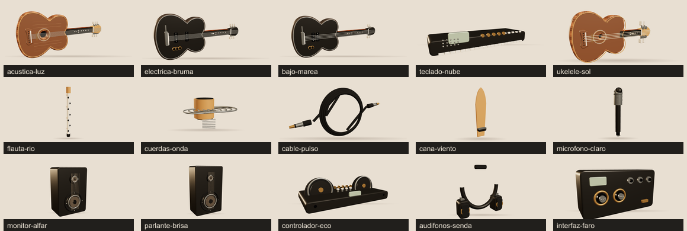

# Evidencia de acabado visual

La comparación enfrenta la versión de inicio del trabajo (`844fc89`) con el árbol corregido, usando Chrome Headless 157, el mismo navegador, cámara y medidas: escritorio 1440×900 y móvil 390×844, ambos DPR 1. Las capturas de Estudio activan el visor y desplazan el modelo al centro de la ventana. La galería incluye una vista frontal de cada ficha; la acústica añade sus vistas giradas de costado y reverso.

## Comparación

| Vista | Antes | Después |
|---|---|---|
| Inicio, escritorio | [captura](antes/desktop-home.png) | [captura](despues/home-desktop.png) |
| Tienda, escritorio | [captura](antes/desktop-tienda.png) | [captura](despues/tienda-desktop.png) |
| Ficha acústica, escritorio | [captura](antes/desktop-producto.png) | [captura](despues/productos-acustica-luz-desktop.png) |
| Estudio 3D, escritorio | [captura](antes/desktop-estudio-visor.png) | [captura](despues/studio-desktop-3d.png) |
| Asesoría, escritorio | [captura](antes/desktop-asesoria.png) | [captura](despues/asesoria-desktop.png) |
| Menú abierto, escritorio | [captura](antes/desktop-menu.png) | [captura](despues/menu-desktop-open.png) |
| Inicio, móvil | [captura](antes/movil-home.png) | [captura](despues/home-mobile.png) |
| Tienda, móvil | [captura](antes/movil-tienda.png) | [captura](despues/tienda-mobile.png) |
| Ficha acústica, móvil | [captura](antes/movil-producto.png) | [captura](despues/productos-acustica-luz-mobile.png) |
| Estudio 3D, móvil | [captura](antes/movil-estudio-visor.png) | [captura](despues/studio-mobile-3d.png) |
| Asesoría, móvil | [captura](antes/movil-asesoria.png) | [captura](despues/asesoria-mobile.png) |
| Menú abierto, móvil | [captura](antes/movil-menu.png) | [captura](despues/menu-mobile-open.png) |

La carpeta `despues/` también contiene Tienda, ficha, Estudio y Asesoría en viewport de 720×450 con DPR 2, equivalente al espacio útil aproximado de una ventana de escritorio ampliada al 200%. No se presenta como medición de zoom del navegador físico.

## Galería del visor

Las quince imágenes se tomaron del canvas WebGL tras seleccionar la ficha indicada. Son modelos procedurales propios e ilustrativos, no fotografías ni reproducciones exactas.

| Ficha | Imagen |
|---|---|
| Yamaha · guitarra acústica | [vista](galeria-3d/acustica-luz.png) · [costado](galeria-3d/acustica-luz-side.png) · [reverso](galeria-3d/acustica-luz-back.png) |
| Squier · guitarra eléctrica | [vista](galeria-3d/electrica-bruma.png) |
| Ibanez · bajo | [vista](galeria-3d/bajo-marea.png) |
| Casio · teclado | [vista](galeria-3d/teclado-nube.png) |
| Kala · ukelele | [vista](galeria-3d/ukelele-sol.png) |
| Yamaha · flauta dulce | [vista](galeria-3d/flauta-rio.png) |
| D’Addario · cuerdas | [vista](galeria-3d/cuerdas-onda.png) |
| Hosa · cable | [vista](galeria-3d/cable-pulso.png) |
| Vandoren · caña | [vista](galeria-3d/cana-viento.png) |
| Behringer · micrófono | [vista](galeria-3d/microfono-claro.png) |
| PreSonus · monitor | [vista](galeria-3d/monitor-alfar.png) |
| Behringer · parlante activo | [vista](galeria-3d/parlante-brisa.png) |
| Numark · controlador DJ | [vista](galeria-3d/controlador-eco.png) |
| Audio-Technica · audífonos | [vista](galeria-3d/audifonos-senda.png) |
| M-Audio · interfaz | [vista](galeria-3d/interfaz-faro.png) |

## Lectura de la evidencia

- La guitarra acústica parte ahora horizontal y en tres cuartos; la cavidad del soundhole y los aros se ven desde el frente. El canvas conserva render al recorrer giros hasta el costado y el reverso.
- El árbol de referencia dibujaba el instrumento de canto: cuerpo y mástil se veían casi de perfil, sin una lectura de guitarra. La captura antes es del commit base y usa la misma escena y viewport que la posterior.
- La auditoría posterior examinó 11 rutas en escritorio, móvil y viewport ampliado: 33 combinaciones, cero desbordamientos horizontales. Las mediciones de contraste del Estudio fueron 14.57:1 para el selector, 13.51:1 para texto/panel, 17.26:1 para títulos y 10.76:1 para texto secundario; todas superan WCAG AA para texto normal en estas superficies.
- La revisión de controles encontró selectores oscuros de 48–50 px con `color-scheme: dark`. En 10 páginas (cinco rutas a dos anchos), un Tab activó un foco de teclado visible de 3 px; el menú móvil abierto contiene 15 enlaces, cabe en el viewport y puede desplazarse.
- La carga inicial de Estudio registró 16 recursos de script; tras activar el visor, 20; tras activar el audio, 21. El motor 3D y el audio se cargaron al usarlos. Estos conteos son evidencia de carga diferida, no una prueba de rendimiento.
- Un script con Chrome Headless verificó canvas WebGL para las 15 fichas y rotó cada una en ambos sentidos; el reporte de navegador y modelos está en `auditoria-post.json` y `modelos-post.json`.

La flauta, la caña, el paquete de cuerdas, el cable y los audífonos continúan siendo formas procedurales simples; el modelo acústico también es una ilustración estilizada. No se incorporaron GLB autorizados ni se comprobó el detalle en teléfono físico o navegador con lector de pantalla. La revisión y aceptación del estudiante siguen pendientes.
